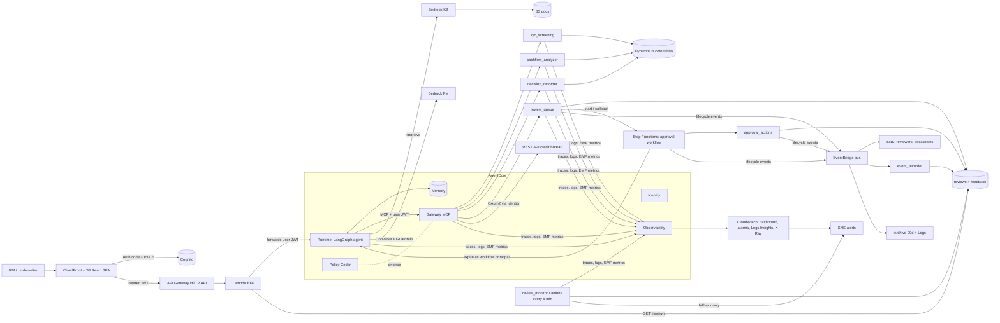
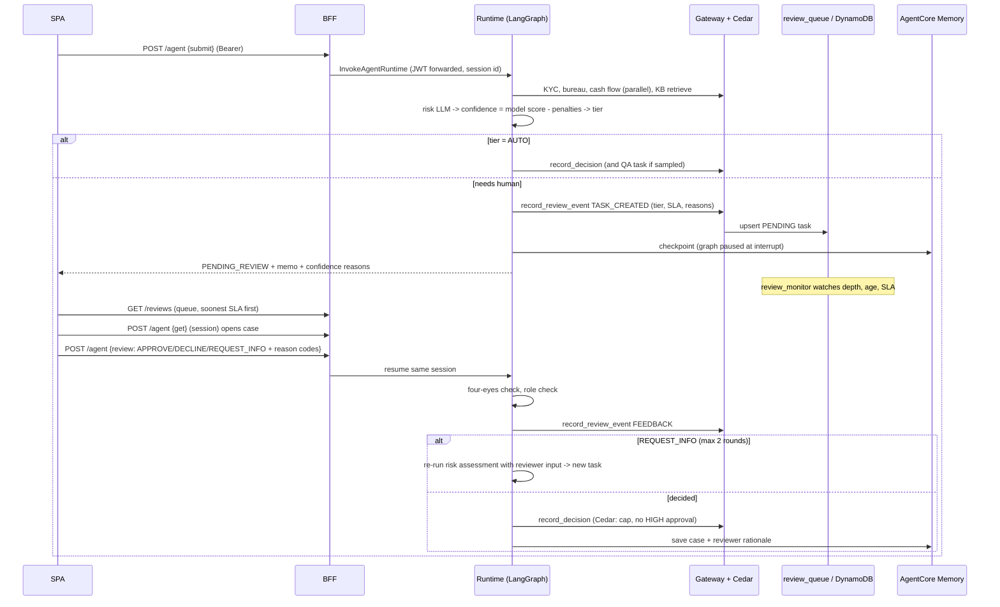
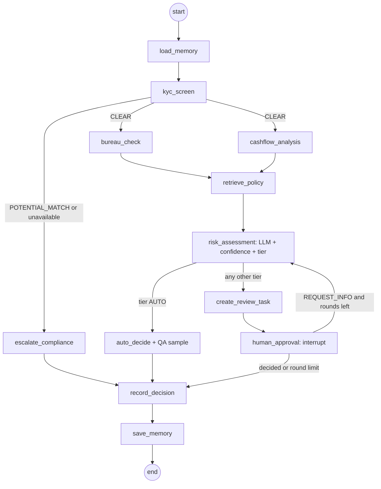
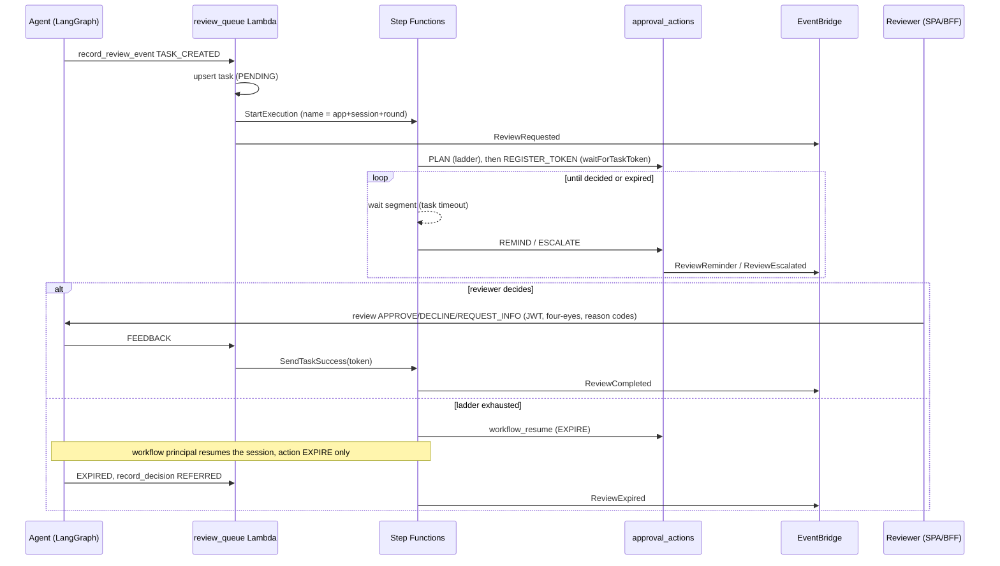
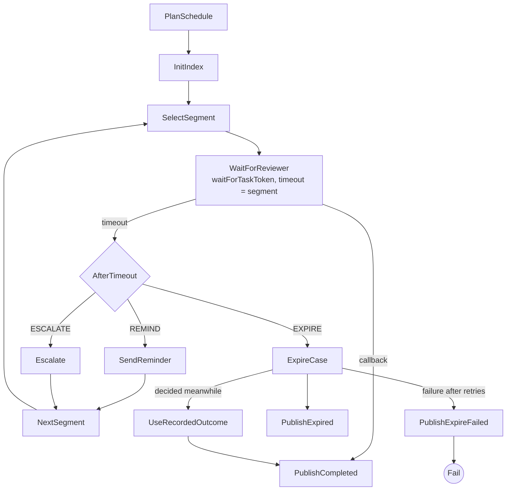
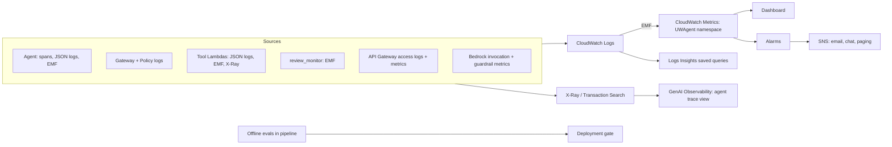

# Design Document — UW-Agent (Agentic SME Credit Underwriting)

Status: Draft v3 (adds the durable human-approval workflow: Step Functions + EventBridge; v2 added human-in-the-loop and observability) · Region: configurable (default `us-east-1`; verify AgentCore and model availability for your region before deploying)

## 1. Goals / non-goals
**Goals** – an enterprise-grade reference implementation that exercises every Amazon Bedrock AgentCore building block (Runtime, Memory, Identity, Gateway, Policy, Observability) with a LangGraph-orchestrated agent; Lambda + REST tools exposed over MCP; a Bedrock Knowledge Base on S3; Cognito OAuth; Terraform; GitHub Actions CI/CD; **a rigorous human-review and feedback loop; end-to-end observability**.
**Non-goals** – a production credit model; the scoring, bureau and sanctions data are synthetic.

## 2. Requirements → implementation map
| Requirement | Implementation |
|---|---|
| AgentCore Runtime | LangGraph agent in an ARM64 container on `aws_bedrockagentcore_agent_runtime` (JWT inbound auth, `Authorization` header propagated) |
| AgentCore Memory | Long-term SEMANTIC + SUMMARIZATION strategies (case history **including reviewer rationale**) + `AgentCoreMemorySaver` as LangGraph checkpointer (review pause/resume) |
| AgentCore Identity | Cognito inbound; workload identity; OAuth2 client-credentials provider for the bureau REST API |
| AgentCore Gateway + MCP | MCP endpoint fronting 4 Lambda targets (KYC, cash flow, decision recorder, **review queue**) + 1 OpenAPI REST target |
| AgentCore Policy | Cedar, default-deny, 5 policies in `/policies` (incl. hard cap and no-approval-of-HIGH-risk) |
| AgentCore Observability | ADOT auto-instrumentation + explicit spans per node and tool, shipped to CloudWatch GenAI Observability / X-Ray |
| LangGraph | Parallel fan-out, conditional routing, `interrupt()` HITL, **request-info loop**, soft-fail nodes |
| Lambda tools | `kyc_screening`, `cashflow_analyzer`, `decision_recorder`, `review_queue` (+ `credit_bureau_mock` behind REST, + scheduled `review_monitor`) |
| REST API tool | API Gateway REST API `GET /v1/credit-score`, Cognito authorizer with scope `bureau/read` |
| DynamoDB | `applicants`, `transactions`, `watchlist`, `applications`, **`reviews`** (queue), **`feedback`** (labels) |
| Knowledge Base on S3 | `aws_bedrockagent_knowledge_base` + S3 data source + S3 Vectors |
| **Human review & feedback** | Section 5: confidence scoring, tiered queue with SLAs, structured reviewer actions, four-eyes, QA sampling, feedback loop |
| **Observability** | Section 6 (plus workflow metrics in 5.8): traces, JSON logs, EMF metrics, dashboard, 12 new alarms, offline evals, audit lineage |
| Cognito OAuth | User pool, groups, resource servers, PKCE SPA client, M2M client |
| **Durable approval workflow** | Section 5.8: Step Functions Standard (`.waitForTaskToken`), reminder/escalation/expiry ladder, EventBridge bus with notification, audit and archive consumers |
| Other AWS | API Gateway (HTTP + REST), Lambda, Secrets Manager, KMS, IAM, ECR, S3, CloudFront, Guardrails, CloudWatch, EventBridge, Step Functions, SNS, SQS |
| Terraform / CI-CD / Python / React | `/infra/terraform` (modules incl. `observability`), `.github/workflows`, Python 3.12, React + TypeScript |

## 3. Architecture

### 3.1 End-to-end sequence (including review)

## 4. LangGraph design

* **State** (`state.py`): application, evidence, confidence and reasons, tier, review round, reviewer clarifications, decision, append-only `errors` and `trace`.
* **Soft-fail evidence nodes**: a failed node records the error and the run continues; the missing evidence lowers confidence and sends the case to a human. KYC failure is the exception — a case never proceeds without screening.
* **Side effects outside interrupt nodes**: nodes that call `interrupt()` re-execute on resume, so task creation lives in its own node (`create_review_task`), and tool writes are idempotent upserts.
* **Tool calls**: 20 s timeout, 2 retries with backoff, span + latency and error metrics per call.
* **Checkpointing**: `AgentCoreMemorySaver` keyed by session id. A runtime microVM can be recycled while a case waits; resuming with the same session id restores the graph from the checkpoint.

## 5. Human-in-the-loop and feedback design

### 5.1 Confidence scoring (`confidence.py`)
Confidence starts from the model's self-reported value (structured output, 0–1) and subtracts deterministic penalties. Each penalty produces a reason string shown to the reviewer.
| Signal | Penalty |
|---|---|
| Any tool/node error | 0.30 |
| Bureau score missing | 0.30 |
| No bank data / fewer than 6 months | 0.30 / 0.10 |
| No policy excerpts retrieved / memo cites no source | 0.25 / 0.15 |
| KYC not CLEAR | 0.30 |
| DSCR within 10 % of floor / bureau score within 20 points of floor | 0.15 each |
| APPROVE contradicts a policy threshold | 0.40 |
| Unparseable model output | forced to 0, REFER |

### 5.2 Routing (`decide_tier`) — deterministic, never model-decided
| Tier | Condition | SLA | Priority |
|---|---|---|---|
| COMMITTEE | amount > hard cap (1,000,000), regardless of confidence | 72 h | 1 |
| AUTO | APPROVE ∧ LOW ∧ amount ≤ 250,000 ∧ confidence ≥ 0.85 | – | – |
| SENIOR | confidence < 0.60 ∨ risk HIGH | 8 h | 1 |
| STANDARD | everything else (all DECLINE/REFER, MEDIUM, mid confidence, larger tickets) | 24 h | 2 |
| QA | non-blocking sample of AUTO approvals (deterministic hash of application id; 10 % prod, 100 % dev) | 72 h | 3 |
All thresholds are environment variables set from Terraform (`confidence_auto_min`, `confidence_review_min`, `qa_sample_rate`, `HITL_AMOUNT_THRESHOLD`, `HARD_CAP_AMOUNT`).

### 5.3 Reviewer actions and controls
* **Actions**: `APPROVE`, `DECLINE`, `REQUEST_INFO`. Approve/decline require ≥ 1 reason code; request-info requires text. The resumed payload carries reviewer identity from the JWT, not from the request body.
* **Authorisation**: group `underwriters` (checked in the agent); scope `underwriting/decision.write` and Cedar on `record_decision`.
* **Four-eyes**: `ENFORCE_FOUR_EYES` rejects a decision by the submitter (metric `FourEyesBlocked`).
* **Loop limit**: after `MAX_REVIEW_ROUNDS` (2) request-info rounds the case is `REFERRED` instead of looping.
* **Hard stops (not overridable by a reviewer here)**: above the cap or HIGH-risk approvals are denied by Cedar even if a reviewer clicks Approve; they require the out-of-system committee path.
* **SLA and escalation**: `review_monitor` (EventBridge, 5 min) escalates each overdue task once through SNS and emits queue metrics.

### 5.4 Data captured per review
`feedback` table row (immutable): reviewer, agent recommendation, human decision, `agreement`, `override` (approve↔decline), reason codes, comment, confidence, tier, risk band, timestamp. `reviews` table row: status (`PENDING`, `IN_REVISION`, `COMPLETED`), tier, priority, SLA due, reasons, session id, round, escalated flag. GSI `status-sla` serves the queue soonest-due first.

### 5.5 Feedback loop — consumers
| Consumer | Mechanism | Cadence | Gate |
|---|---|---|---|
| Agent memory | Reviewer action, codes and comment appended to the case summary stored in AgentCore Memory (semantic strategy per applicant) | per case | none (read-only context) |
| Evaluation set | `scripts/export_feedback_to_golden.py` exports human-labelled cases; Model Risk completes tool fixtures and merges into `evals/golden_cases.jsonl` | weekly | Model Risk review |
| Calibration | `AgreementRate` and `OverrideRate` by confidence bucket (high ≥ 0.85, mid, low) computed by `review_monitor` | 5 min metric, monthly review | PR changing thresholds |
| Policy / KB | Recurring reason codes such as `POLICY_EXCEPTION_GRANTED` indicate ambiguous or outdated policy text | monthly | policy owner updates `kb_docs/`, re-ingest |
| Prompt / routing rules | Findings from overrides (e.g. `AGENT_MISREAD_EVIDENCE`) | as needed | PR + passing regression evals; `PROMPT_VERSION` bumped and stamped on every decision |
No component changes production behaviour automatically; all changes are reviewed and released through the pipeline.

### 5.6 Calibration procedure
1. For each confidence bucket compute agreement (human decision equals agent recommendation) over the last 30 days.
2. If agreement in the **high** bucket falls below 85 %, raise `confidence_auto_min` (fewer straight-through cases) and add penalties for the failure pattern.
3. If the **low** bucket agrees ≥ 90 %, consider lowering `confidence_review_min` (less reviewer load).
4. Re-run evals, release via PR, watch the routing-tier mix and override rate for a week.

### 5.7 Failure modes
| Failure | Mitigation |
|---|---|
| Reviewer rubber-stamping | Mandatory reason codes; QA sample; per-reviewer approve-without-comment and time-to-decision analytics (from `feedback` + traces); blind cases |
| Queue starvation / reviewer absence | Depth, oldest-age and SLA-breach alarms; SNS escalation; tiered priority |
| Duplicate submissions / retries | Idempotent upserts and conditional decision write |
| Reviewer disagrees repeatedly with the same signal | Override trend alarm; reason-code Pareto in monthly review |
| Reviewer never responds | Step Functions ladder: reminders, escalations, expiry to REFERRED, alarms (5.8) |
| Stale session / runtime recycled | Checkpoint restore by session id; `get` action rebuilds the case view |
| Feedback poisoning (bad labels) | Labels reviewed by Model Risk before joining the golden set; no automatic learning |

### 5.8 Durable human-approval workflow (Step Functions + EventBridge)

#### Why
LangGraph's `interrupt()` plus a checkpoint can *hold* a case for days, but nothing in that pair *keeps time*: no reminder, no escalation, no expiry, no notification, and the only watchdog was a 5-minute poller that alerted once. Step Functions Standard is built for this (durable, up to one year, per-execution history); EventBridge fans the lifecycle out to people and systems.

#### Responsibilities (nothing is duplicated)
| Concern | Owner |
|---|---|
| Reasoning, confidence, routing, the paused case, request-info loop | LangGraph + AgentCore Memory checkpoint |
| Authorisation of a decision (underwriters group, four-eyes, reason codes, Cedar) | Agent + Gateway/Cedar (unchanged) |
| **Time**: waiting, reminders, escalation, expiry | **Step Functions** |
| **Notification, timeline, integration** | **EventBridge** consumers |

#### Flow

#### State machine (`modules/approval_workflow/asl.json.tftpl`)

The schedule is data (`approval_actions.build_schedule`), so a ladder change does not alter the state machine.

#### Default ladder
| Tier (SLA) | Remind | Escalate L1 | Remind | Escalate L2 | Expire after |
|---|---|---|---|---|---|
| STANDARD (24 h) | 12 h | 24 h → SENIOR | +4 h | +8 h | + 24 h grace (≈ 68 h) |
| SENIOR (8 h) | 4 h | 8 h | +4 h | +8 h | + 24 h grace (≈ 40 h) |
| COMMITTEE (72 h) | 36 h | 72 h | +36 h | +72 h | + 24 h grace (≈ 168 h) |
`workflow_time_scale` multiplies every wait (dev uses 0.01, so 24 h ≈ 15 min); `workflow_expiry_grace_hours` sets the grace.

#### Correctness and safety properties
* **Task token = capability.** Stored on the task row, never returned by the BFF (allow-list), not logged (`include_execution_data = false`), state machine encrypted with the CMK.
* **Race-safe callback.** A decision clears the token and calls `SendTaskSuccess`; a stale or timed-out token is ignored. Every wait begins with `REGISTER_TOKEN`, which re-reads the row and completes immediately if a decision landed in the gap between steps.
* **Expiry vs decision.** `workflow_resume` claims the task atomically (`PENDING → EXPIRING`); if a decision already exists it reports `skipped` and the workflow publishes that outcome. A decision after the claim is counted as `ReviewLateDecisions`.
* **Idempotent steps.** Each REMIND/ESCALATE records `last_action_idx`; Step Functions retries never escalate twice. EventBridge is at-least-once, so the recorder deduplicates by event id.
* **Round-aware.** `REQUEST_INFO` ends that round's execution; the next `TASK_CREATED` starts a new one (name includes the round). Steps ignore tasks whose round has moved on.
* **No authority to decide.** The workflow principal is a dedicated Cognito client with one scope, `underwriting/system.resume`. The agent accepts only `EXPIRE` from it (and rejects `EXPIRE` from humans); Cedar policy 06 lets it record only `REFERRED` at any amount, policy 07 forbids anything else. `EXPIRE` writes no `feedback` row.
* **Fail-soft start.** If `StartExecution` fails, the task is still created, `WorkflowStartErrors` fires, and the monitor's fallback escalation covers it; `ReviewTasksWithoutWorkflow` alarms.

#### Event catalogue (bus `<name>-events`, source `uw.underwriting`)
| Detail-type | Emitted by | Key detail fields | Consumers |
|---|---|---|---|
| `ReviewRequested` | review_queue | tier, sla_due, confidence, round | reviewers topic, timeline |
| `ReviewReminder` | approval_actions | tier, level, audience, sla_due | reviewers topic, timeline |
| `ReviewEscalated` | approval_actions | from_tier, to_tier, level, audience, hours_overdue | escalations topic, timeline |
| `ReviewCompleted` | Step Functions (native) | outcome.action, reviewer, reason codes | timeline |
| `ReviewExpired` | Step Functions | decision (REFERRED) | escalations topic, timeline |
| `ReviewExpireFailed`, `ReviewWorkflowFailed` | Step Functions | error | escalations topic, timeline |
| `ComplianceReferred` | review_queue (from the agent) | reason | escalations topic; hook for case management |
Rules: notifications (two SNS topics, input transformer), `event_recorder` Lambda (timeline items `EVT#…` in the `reviews` table, sparse so absent from the queue index), log group (Logs Insights), 90-day archive (replay). Targets have a retry policy and an SQS dead-letter queue with an alarm.

#### Data model additions (`reviews` table)
`status` gains `EXPIRING`, `EXPIRED`. New task attributes: `escalation_level`, `reminders_sent`, `original_tier`, `escalated_at`, `workflow_state` (NONE, PLANNED, WAITING, COMPLETED, EXPIRING, EXPIRED), `workflow_deadline`, `execution_arn`, `task_token` (internal), `outcome`, `last_action_idx`. Timeline rows: `sk = EVT#<time>#<type>#<id>`.

#### API and UI
`GET /reviews` returns an allow-listed projection with escalation fields. `GET /reviews/{application_id}/timeline` returns the events. The queue shows escalation level and original tier; a timeline card appears when a case is opened.

#### Observability
Metrics: `ReviewRemindersSent`, `ReviewEscalations` (Level), `ReviewExpirations`, `ReviewEscalatedOpen`, `ReviewTasksWithoutWorkflow`, `ReviewLateDecisions`, `ReviewTimeToDecisionMinutes` (Tier), `WorkflowStartErrors`, `WorkflowCallbackErrors`, `EventPublishErrors`. Alarms: escalation L2, expiry, tasks without workflow, start/callback/publish errors, Step Functions `ExecutionsFailed/TimedOut/Aborted`, DLQ not empty, per-Lambda errors. Dashboard gets a workflow section.

#### Testing
Unit and moto tests cover the ladder, idempotent reminders and escalation, token registration and the decision-in-the-gap race, expiry claim and retry, expiry losing to a decision, recorder idempotency, and ASL structure (all targets exist, no approve/decline state, token never logged). Agent tests cover who may EXPIRE and that expiry refers without writing feedback. The dev time scale gives an end-to-end smoke test in minutes.

## 6. Observability

### 6.1 Questions it must answer
Is it up and fast? Is it correct and calibrated? Is it safe and within policy? Is the human loop healthy? What does it cost? Who did what, with which model and policy version?

### 6.2 Telemetry architecture

### 6.3 Signals
| Signal | Where | Notes |
|---|---|---|
| Traces | Runtime ADOT → X-Ray / GenAI Observability | One trace per invocation: `invoke.<action>` → `node.<name>` → `tool.<tool>`; attributes `uw.application_id`, `uw.session_id`, `enduser.id`, `uw.tool`, `uw.attempt`; exceptions recorded on spans |
| Logs | Runtime and Lambdas, JSON | Fields: `trace_id`, `session_id`, `application_id`, `node`, `tool`, `request_id`. Only identifiers are logged — no names, amounts of personal data or free text. Retention 90 days, KMS encrypted |
| Metrics | CloudWatch Embedded Metric Format (stdout, no API calls) | Namespace `UWAgent`; every metric has `Service` (agent / tool / review) and optional dimensions |
| Audit | `applications` DECISION + immutable AUDIT items; `feedback` | Includes `trace_id`, `model_id`, `prompt_version`, `policy_version`, tier, confidence, policy sources, decider |
| Evaluation | `evals/run_evals.py`; optional AgentCore online evaluation on sampled traces | See 6.8 |

### 6.4 Metric catalogue (`UWAgent`)
| Metric | Dimensions | Source | Answers |
|---|---|---|---|
| `TimeToRecommendationMs` | Tier | agent | speed (SLO) |
| `RoutingTier` | Tier | agent | mix of AUTO vs human tiers, drift |
| `Confidence` | Tier | agent | confidence distribution |
| `Decisions` | Decision, Tier | agent | outcomes |
| `NodeLatencyMs`, `NodeErrors` | Node | agent | where time goes, where it fails |
| `GatewayToolLatencyMs`, `GatewayToolErrors` | Tool | agent | tool health as the agent sees it |
| `ToolInvocations`, `ToolErrors`, `ToolLatencyMs` | Tool | Lambdas | tool health as the tool sees it |
| `LlmInputTokens`, `LlmOutputTokens` | – | agent | cost, runaway prompts |
| `GuardrailInterventions` | – | agent | safety events |
| `ComplianceReferrals` | Reason | agent | sanctions / screening outages |
| `FourEyesBlocked`, `ReviewActions` | Action, Tier | agent | control effectiveness, reviewer behaviour |
| `ReviewQueueDepth` | Tier | monitor | backlog |
| `ReviewOldestAgeMinutes`, `ReviewSlaBreaches` | – | monitor | SLA health |
| `AgreementRate`, `OverrideRate` | ConfidenceBucket | monitor | calibration and trust |

### 6.5 SLIs / SLOs (initial)
| SLI | SLO |
|---|---|
| p95 time to recommendation (non-human path) | < 120 s |
| Tool call success after retries | ≥ 99.5 % |
| Review SLA met | ≥ 95 % |
| Agreement, high-confidence bucket | ≥ 90 % (alert < 85 %) |
| Straight-through cases later found defective in QA | < 2 % |
| BFF availability / p95 latency | 99.9 % / < 25 s (hard limit 30 s) |

### 6.6 Alarms (Terraform `modules/observability`, all notify the SNS topic)
| Alarm | Trigger | First response |
|---|---|---|
| gateway-tool-errors | ≥ 3 in 5 min | Check Gateway target, tool Lambda logs, bureau OAuth token |
| node-errors | ≥ 3 in 5 min | Open trace in GenAI Observability, find failing node |
| time-to-recommendation-p95 | > 2 min for 15 min | Check Bedrock throttling/latency, tool latency widget |
| review-sla-breach | ≥ 1 | Page the queue owner; reassign |
| review-oldest-age | > 8 h for 15 min | Check staffing; consider widening reviewer group |
| override-rate-high | > 25 % for 3 h | Model Risk review; possible drift or policy change |
| low-conf-agreement (high bucket) | < 85 % for 3 h | Confidence miscalibrated: raise auto threshold |
| guardrail-spike | ≥ 5 in 15 min | Inspect for prompt attack or data issue |
| compliance-referral | ≥ 1 | Compliance notified; confirm screening service health |
| four-eyes-blocks | ≥ 3 in 1 h | Review access patterns |
| llm-output-tokens-anomaly | outside learned band | Check prompt loops, abuse, cost |
| bff-5xx, bff-latency-p95, per-Lambda errors | thresholds | Standard API/Lambda runbook; consider async pattern |

### 6.7 Dashboard (`<name>-overview`)
Routing-tier mix · time to recommendation p50/p95 · confidence by tier · queue depth by tier · oldest pending and SLA breaches · agreement and override rate · gateway tool latency · errors (tools, nodes, four-eyes, compliance) · tokens and guardrail interventions · decisions by outcome · BFF 4xx/5xx/latency. Logs Insights saved query `case-timeline-by-application` reconstructs one case across tool logs.

### 6.8 Evaluation
* **Offline regression (gate)**: `evals/golden_cases.jsonl` with canned tool outputs, run against the real model and Knowledge Base after each dev deployment (`--min-pass 0.8`); checks recommendation, tier, confidence ceiling and citation presence. Fast deterministic graph tests (HITL pause/resume, request-info loop, tool failure) run in CI without AWS.
* **Online**: enable AgentCore Evaluations on sampled production traces for goal success and tool-selection quality where available in your region, alongside the human QA sample.
* **Human-labelled**: reviewer feedback exports feed the golden set.

### 6.9 Audit, lineage and privacy
Every decision stores `trace_id`, `model_id`, `prompt_version`, `policy_version`, tier, confidence and policy sources, so any outcome can be replayed against the exact trace and configuration. Add CloudTrail data events for the decision tables for regulator-grade evidence. Logs and metrics never contain names or free-text; the Guardrail anonymises e-mail addresses and blocks card numbers in model I/O.

### 6.10 One-time setup
Enable CloudWatch Transaction Search (done idempotently by the deploy workflow) so AgentCore traces appear in GenAI Observability. Subscribe the on-call address (`alarm_email`) to the SNS topic and confirm.

## 7. Data model (DynamoDB, on-demand, KMS, PITR)
| Table | Keys | Notes |
|---|---|---|
| applicants | `applicant_id` | kyc_status, vintage |
| transactions | `applicant_id` / `txn_ts` | CREDIT/DEBIT, amount |
| watchlist | `name_key` | normalised entity name |
| applications | `application_id` / `sk` | `DECISION` current + `AUDIT#<ts>`; stores tier, confidence, trace_id, prompt/policy versions |
| reviews | `application_id` / `sk=TASK`; GSI `status-sla` (`status`, `sla_due`) | review queue |
| feedback | `application_id` / `feedback_ts` | immutable reviewer labels |

## 8. Knowledge Base
S3 `kb_docs/` → Bedrock KB (Titan Text Embeddings v2) → S3 Vectors. The deploy workflow starts ingestion and waits for completion before running evals.

## 9. Security
* No static AWS keys: GitHub OIDC → deploy role.
* KMS CMK for DynamoDB, S3, Secrets Manager, ECR, SNS, Lambda environment.
* Scopes `underwriting/agent.invoke`, `underwriting/decision.write`, `underwriting/system.resume` (workflow only), `bureau/read`; group `underwriters` for reviews; four-eyes.
* Cedar (default-deny), 7 policies: read tools, record decision ≤ cap, forbid approval above cap, forbid approval of HIGH risk, allow review events, allow the workflow principal to record REFERRED only, forbid it anything else.
* Bedrock Guardrail: prompt-attack filter, PII, protected-attribute topic denial.
* STRIDE highlights — *Spoofing*: JWT at three layers; reviewer identity from token. *Tampering*: conditional writes, immutable feedback/audit. *Repudiation*: reviewer id, reason codes, trace id. *Info disclosure*: CMK, ids-only logs. *Elevation*: Cedar, four-eyes, group check.
* Roadmap: VPC-attached Runtime/Lambda with endpoints, WAF, Macie.

## 10. CI/CD
`ci.yml` (PR): ruff, pytest (tool tests, routing/confidence tests, graph HITL tests), frontend typecheck and build, `terraform fmt/validate`, tflint, checkov, Docker build. `deploy.yml`: OIDC → ECR bootstrap → ARM64 image → full apply → enable Transaction Search → KB ingestion (wait) → apply Cedar → seed (non-prod) → **offline evals gate** → build/publish SPA → smoke test → prints the dashboard link. Prod requires environment approval.

## 11. Deployment order
1. `scripts/bootstrap_state.sh`; GitHub OIDC role; repo secrets.
2. Edit `envs/*.tfvars` (model id, alarm email, thresholds).
3. Push to `main`.
4. Create two Cognito users in group `underwriters` in dev when `enforce_four_eyes = true` (dev tfvars disables it for single-user testing).

## 12. Cost drivers
Step Functions Standard bills per state transition: about 6 to 12 per review (more with reminders), negligible next to Bedrock tokens. EventBridge, SNS, SQS and the extra Lambdas are small.
Bedrock tokens (dominant; watch `LlmInputTokens`/`LlmOutputTokens` and the anomaly alarm), AgentCore consumption, CloudWatch ingestion (JSON logs + EMF; keep logs ids-only), S3 Vectors. The 5-minute monitor and queue tables are negligible.

## 13. Known limitations / assumptions
* AgentCore Terraform resources, Cedar policy APIs, `AgentCoreMemorySaver` and Evaluations are recent; names track provider ≥ 6.x at time of writing — run `terraform validate` and adjust.
* HTTP API 30 s integration limit: if the non-human path exceeds it, switch the BFF to an async job pattern (the BFF latency alarm warns at 25 s).
* `review_monitor` scans the last 7 days of feedback; use a GSI or an Athena export at scale.
* Compliance referral raises an alert, not a case in a case-management system (phase 2).
* Four-eyes needs at least two reviewers; the agent trusts the group claim in the validated token.
* Sanctions matching is a demo fuzzy match.
* A reviewer decision racing an expiry claim in the same instant can resume the session twice; the atomic claim and `ReviewLateDecisions` bound and expose it, but a hard lock is not implemented.
* Escalation recipients are SNS topics (email by default); routing to named people, Slack/Teams interactive approval, claim/reassign and deadline extension are phase 2.
* Verify Step Functions customer-managed-key support and EventBridge-to-encrypted-SNS key policy in your provider and region; run `terraform fmt` before the first CI run.

## 14. Roadmap
Interactive approve/decline from Slack or Teams through the same callback; reviewer claim and reassignment; deadline-extension requests; per-tier configurable ladders; Reviewer workload balancing and assignment; calibration report generated monthly; online evaluation dashboards; async BFF; VPC hardening; compliance case-management integration.
